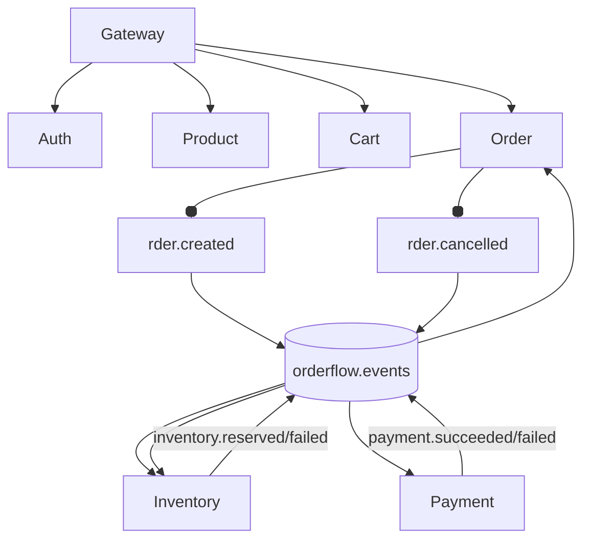

# Architecture
Each service is an independent Spring Boot application and owns one PostgreSQL schema. Services never write another schema. Synchronous public traffic enters the Gateway; checkout coordination uses durable RabbitMQ queues.

Messages use JSON typed records from `shared-contracts`. Queues are durable, rejected messages are not endlessly requeued, listener retry is capped at three attempts, and queues declare `orderflow.dlx` as their dead-letter exchange. Consumer-owned `processed_events` tables enforce idempotency. A production version should use an outbox to close the database-commit/message-publish gap.

Gateway JWT parsing adds trusted `X-User-ID`, `X-User-Role`, and `X-Correlation-ID` headers. Services remain responsible for domain validation. Redis is limited to product reads and cart views; PostgreSQL remains authoritative.
