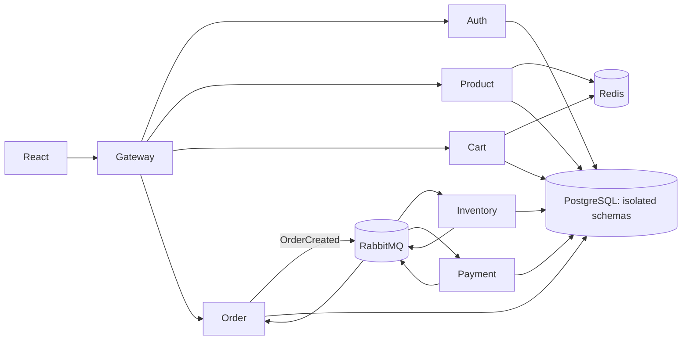

# OrderFlow — Event-Driven E-Commerce Microservices Platform
**Engineering Reliable Commerce Through Distributed Services.**

OrderFlow is a Java 21/Spring Boot portfolio backend that demonstrates database-per-service ownership, JWT security, Redis caching, RabbitMQ events, idempotent consumers, atomic stock reservation, and Saga-style checkout compensation. It is educational software, not a production commerce claim.

## Services
| Service | Port | Responsibility |
|---|---:|---|
| API Gateway | 8080 | Routes, JWT validation, correlation IDs |
| Auth | 8081 | BCrypt registration/login, access/refresh tokens, roles |
| Product | 8082 | CRUD, search, pagination, Redis read cache |
| Cart | 8083 | Persistent carts, totals, Redis cart cache |
| Order | 8084 | Checkout, history, state machine, Saga coordination |
| Inventory | 8085 | Atomic reservation/release and oversell prevention |
| Payment | 8086 | Deterministic simulated outcomes, idempotency, refunds |



## Stack
Java 21, Spring Boot 3.5.16, Spring Cloud 2025.0.3, Gateway, Security, JPA/Hibernate, Flyway, PostgreSQL, Redis, RabbitMQ, Maven, JUnit 5, React 19, TypeScript, Docker Compose, OpenAPI.

## Build
```bash
mvn clean test
cd frontend && npm install && npm run build
docker compose config
docker compose up --build
```
Use a JDK 21 runtime. Swagger is exposed by MVC services at `/swagger-ui.html`. The public API is `http://localhost:8080/api` and the UI is `http://localhost:3000`.

For an 8 GB laptop, start infrastructure first (`docker compose up postgres redis rabbitmq`) and run only the services being developed from the IDE. The full stack is roughly 2–3 GB before build caches; no Kubernetes or monitoring stack is required.

## Checkout
Order creates `PENDING` state → inventory atomically reserves every line → payment produces a deterministic simulated success/failure → order confirms or cancels → cancellation releases reservations. Consumers store event IDs before accepting duplicate delivery. This is a Saga with local transactions, not distributed ACID. See [CHECKOUT_FLOW.md](CHECKOUT_FLOW.md).

## Commands and evidence
- Backend tests: `mvn test`
- Frontend: `npm run build`
- Compose validation: `docker compose config`
- Load script: `powershell -File scripts/load-test.ps1 -Requests 500 -Concurrency 10`

No benchmark numbers are published until the stack is running and the script measures them. See [DEMO.md](DEMO.md), [API_DOCUMENTATION.md](API_DOCUMENTATION.md), and [INTERVIEW_GUIDE.md](INTERVIEW_GUIDE.md).

## Limitations
Static service URLs; no service discovery, tracing backend, transactional outbox, real payment provider, PCI data, replication, multi-region deployment, or production SLA. JWT revocation is refresh-token based; authorization is intentionally lightweight. The React client is a functional thin client, not a complete storefront.
