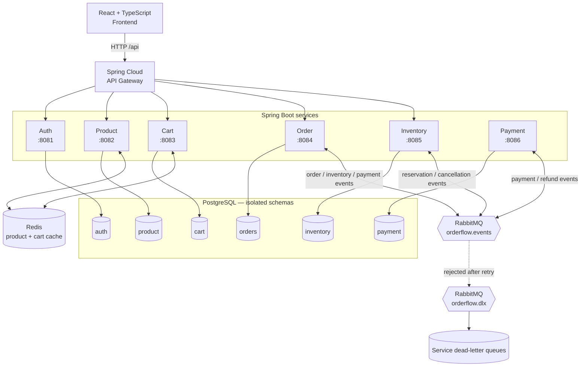
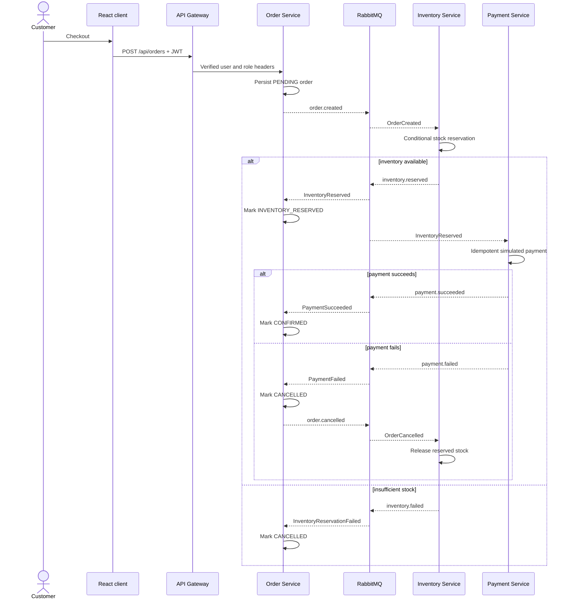

<div align="center">

# OrderFlow

### Orchestrating Commerce Through Events.

An event-driven e-commerce platform built to explore service boundaries, asynchronous checkout,
data ownership, idempotency, and failure compensation with Java and Spring Boot.

<kbd>Java 21</kbd> · <kbd>Spring Boot 3.5</kbd> · <kbd>PostgreSQL 17</kbd> · <kbd>Redis 7</kbd> · <kbd>RabbitMQ 4</kbd> · <kbd>React 19</kbd> · <kbd>TypeScript 5</kbd> · <kbd>Docker Compose</kbd>

[Overview](#overview) · [Architecture](#architecture) · [Checkout](#checkout-workflow) · [Getting started](#getting-started) · [API](#api-and-service-ports) · [Verification](#verification-status) · [Documentation](#documentation)

</div>

> [!IMPORTANT]
> OrderFlow is an educational distributed-systems project. Its automated tests and frontend build have been verified, but the complete Docker checkout flow has not yet been executed on the audited machine. It is not presented as production-ready.

## Overview

OrderFlow separates authentication, catalog, cart, order, inventory, and payment responsibilities into independently runnable Spring Boot services behind a single API Gateway. Each service owns its PostgreSQL schema and persistence model; no service writes another service's tables.

Synchronous client traffic enters through the Gateway. Checkout then moves to RabbitMQ so inventory and payment can process independently without a distributed database transaction. Inventory is reserved with a conditional database update, and consumers record processed event IDs to make duplicate delivery harmless. If the simulated payment fails, Order publishes a cancellation event and Inventory releases the reservation—a Saga-style compensation rather than distributed ACID.

### Service map

| Component | Port | Responsibility |
|---|---:|---|
| API Gateway | `8080` | Routing, JWT verification, role checks, trusted identity and correlation headers |
| Auth Service | `8081` | Registration, BCrypt credentials, access tokens, refresh-token rotation |
| Product Service | `8082` | Catalog CRUD, search, pagination, Redis read caching |
| Cart Service | `8083` | Persistent carts, ownership checks, totals, Redis caching |
| Order Service | `8084` | Checkout, order history, state transitions, Saga coordination |
| Inventory Service | `8085` | Atomic reservation, release, oversell prevention |
| Payment Service | `8086` | Deterministic simulated outcomes, idempotent payment records, refunds |
| Frontend | `3000` | React/TypeScript product, authentication, cart, and checkout client |

## Architecture



Public HTTP access is routed through the Gateway. The Payment Service is an asynchronous Saga participant and has no Gateway route. Compose binds service diagnostic ports to loopback; only the Gateway should be exposed beyond a development machine.

## Key engineering features

| Area | Implementation |
|---|---|
| Authentication | HMAC-signed JWT access tokens, 15-minute expiry, BCrypt cost 12 |
| Refresh security | Random opaque refresh tokens stored as SHA-256 hashes, expiry checks, rotation on use |
| Authorization | Gateway `ADMIN` enforcement for catalog mutations and inventory; cart/order ownership checks |
| Trusted identity | Client identity headers are removed and rebuilt from verified JWT claims |
| Caching | Redis-backed product-by-ID and cart views with mutation-driven eviction and configured TTLs |
| Checkout | RabbitMQ topic exchange with typed events from `shared-contracts` |
| Inventory safety | Conditional `UPDATE` reserves only when `available >= requested` |
| Idempotency | Consumer-owned `processed_events` tables plus unique payment/order constraints |
| Compensation | Payment failure cancels the order and releases reserved stock |
| Failure isolation | Durable queues, three listener attempts, `orderflow.dlx`, and service-specific DLQs |
| Trace context | Gateway-generated or forwarded `X-Correlation-ID` on synchronous requests |
| Data evolution | Flyway migrations and Hibernate schema validation for each owned schema |
| API discovery | Springdoc OpenAPI and Swagger UI on the configured MVC services |

## Checkout workflow



Database commits and event publication are not atomic because the project does not yet implement a transactional outbox. That gap is documented rather than hidden.

## Technology stack

| Layer | Technology |
|---|---|
| Backend | Java 21, Spring Boot 3.5.16, Spring Cloud Gateway, Spring Security, Spring Data JPA, Hibernate, Bean Validation, Actuator |
| Frontend | React 19.2, TypeScript 5.9, Vite 7.1 |
| Data | PostgreSQL 17, Flyway, Redis 7.4, schema-per-service ownership |
| Messaging | RabbitMQ 4.1, Spring AMQP, durable topic exchanges and queues |
| API | REST/JSON, JWT bearer authentication, Springdoc OpenAPI |
| Infrastructure | Maven 3.9+, Docker, Docker Compose, Nginx |
| Testing and delivery | JUnit 5, Mockito, Maven Surefire, npm, GitHub Actions |

## Repository structure

```text
OrderFlow/
├── api-gateway/          # HTTP routing, JWT and authorization boundary
├── auth-service/         # Users, credentials, access and refresh tokens
├── product-service/      # Catalog and Redis-backed product reads
├── cart-service/         # Persistent user carts and totals
├── order-service/        # Checkout state and Saga coordination
├── inventory-service/    # Atomic reservation and compensation
├── payment-service/      # Simulated payment and refund processing
├── shared-contracts/     # Typed RabbitMQ event records
├── frontend/             # React/TypeScript client and Nginx image
├── docker/               # Shared service image and PostgreSQL bootstrap
├── postman/              # Importable API request collection
├── scripts/              # Local HTTP load-test script
├── .github/workflows/    # Backend and frontend CI
├── docker-compose.yml
└── pom.xml               # Nine-module Maven reactor
```

## Getting started

### Prerequisites

- JDK 21 with `JAVA_HOME` configured
- Maven 3.9 or newer
- Node.js 22 and npm
- Docker Desktop or Docker Engine with Compose
- Approximately 3 GB of free memory for the full local stack

Confirm the toolchain:

```bash
java -version
mvn -version
node --version
npm --version
docker version
docker compose version
```

### Configure the environment

Create a local environment file from the safe template:

```bash
# Linux / macOS
cp .env.example .env

# Windows PowerShell
Copy-Item .env.example .env
```

Set non-default local values in `.env`:

| Variable | Purpose |
|---|---|
| `POSTGRES_DB` | Local PostgreSQL database name |
| `POSTGRES_USER` | Local database user |
| `POSTGRES_PASSWORD` | Local database password; replace the example value |
| `JWT_SECRET` | HMAC key; use at least 32 random characters |
| `PAYMENT_FAILURE_RATE` | Simulated payment failure ratio from `0.0` to `1.0` |

`.env` is ignored by Git. Never commit real secrets.

### Build and test

```bash
mvn clean test

cd frontend
npm ci
npm run build
cd ..

docker compose config --quiet
```

The latest audited machine could run the cached `mvn test`, but its clean phase could not download an uncached Maven plugin because host DNS resolution failed. See [runtime verification](FINAL_RUNTIME_VERIFICATION.md) for the exact evidence.

### Start the stack

```bash
docker compose up --build --wait
docker compose ps
```

Open the frontend at `http://localhost:3000` and send API requests to `http://localhost:8080/api`. RabbitMQ management is mapped to `http://localhost:15672` for local inspection.

For an 8 GB development machine, start infrastructure first and run only the services under active development from the IDE:

```bash
docker compose up -d postgres redis rabbitmq
```

Stop containers without deleting data:

```bash
docker compose down
```

Use `docker compose down -v` only when intentionally removing the local PostgreSQL volume.

## API and service ports

All normal client requests go through `http://localhost:8080`. Send protected requests with:

```http
Authorization: Bearer <access-token>
Content-Type: application/json
```

Core endpoints include:

| Method | Gateway path | Access |
|---|---|---|
| `POST` | `/api/auth/register` | Public |
| `POST` | `/api/auth/login` | Public |
| `POST` | `/api/auth/refresh` | Public refresh token exchange |
| `GET` | `/api/products` | Public |
| `POST / PUT / DELETE` | `/api/products...` | ADMIN |
| `GET / PUT / DELETE` | `/api/carts/{userId}...` | Owner or ADMIN |
| `POST / GET` | `/api/orders...` | Authenticated owner or ADMIN |
| `PUT` | `/api/inventory/{productId}` | ADMIN |

Springdoc is configured on the Auth, Product, and Cart services:

- Auth: `http://localhost:8081/swagger-ui.html`
- Product: `http://localhost:8082/swagger-ui.html`
- Cart: `http://localhost:8083/swagger-ui.html`
- OpenAPI JSON: replace `/swagger-ui.html` with `/v3/api-docs`

These diagnostic service ports are bound to `127.0.0.1` by Compose. See [API_DOCUMENTATION.md](API_DOCUMENTATION.md) for payloads and status codes, and import `postman/OrderFlow.postman_collection.json` for starter requests.

## Verification status

Evidence recorded on 2026-11-01:

| Check | Result | Scope |
|---|---|---|
| Cached Maven `test` | **Passed** | 15 tests, 0 failures across the nine-module reactor |
| Frontend `npm ci` | **Passed** | Lockfile-based installation |
| Frontend production build | **Passed** | Strict TypeScript and Vite build |
| Compose configuration | **Passed** | `docker compose config --quiet` |
| Clean Maven build | **Blocked** | Host DNS could not resolve an uncached Maven Clean Plugin |
| Docker Linux engine | **Unavailable** | Engine did not initialize during the audited run |
| Full checkout runtime | **Not executed** | No containerized end-to-end result claimed |
| Compensation / duplicates / DLQ | **Unit-tested in part** | Live RabbitMQ/PostgreSQL behavior remains unverified |
| Performance benchmark | **Not run** | No throughput or latency figures are claimed |

Automated tests cover authentication failures, refresh replay, malformed credentials, Gateway 401/403 behavior, identity-header replacement, insufficient inventory, reservation release, duplicate inventory/payment events, payment failure, and consumer exception propagation. They do not replace a live integration test.

## Known limitations

- No transactional outbox; a crash can occur between database commit and event publication.
- No service discovery, service-to-service authentication, distributed tracing backend, rate limiting, or access-token denylist.
- Payment is deterministic simulation and accepts no card data.
- Internal services trust identity headers supplied by the Gateway.
- Runtime migrations, broker retry/DLQ movement, container health, and concurrent PostgreSQL reservation behavior remain to be verified together.
- The frontend is a focused demonstration client, not a complete storefront.

## Roadmap

- [ ] Complete Docker Compose runtime verification on a working Linux engine
- [ ] Add Testcontainers coverage for PostgreSQL, Redis, and RabbitMQ
- [ ] Exercise successful checkout and payment-failure compensation end to end
- [ ] Verify duplicate delivery, retry exhaustion, DLQ inspection, and recovery procedures
- [ ] Add a transactional outbox/inbox boundary
- [ ] Record reproducible HTTP throughput and p50/p95/p99 latency results
- [ ] Add structured logs, metrics, and distributed tracing

## Documentation

| Document | Purpose |
|---|---|
| [DEMO.md](DEMO.md) | Local demonstration and failure walkthrough |
| [INTERVIEW_GUIDE.md](INTERVIEW_GUIDE.md) | Architecture explanations and implementation questions |
| [API_DOCUMENTATION.md](API_DOCUMENTATION.md) | Endpoint, payload, authorization, and response reference |
| [ARCHITECTURE.md](ARCHITECTURE.md) | Service boundaries, data ownership, and messaging design |
| [CHECKOUT_FLOW.md](CHECKOUT_FLOW.md) | Saga sequence and compensation path |
| [FINAL_ENGINEERING_AUDIT.md](FINAL_ENGINEERING_AUDIT.md) | Source, security, testing, and reliability audit |
| [FINAL_RUNTIME_VERIFICATION.md](FINAL_RUNTIME_VERIFICATION.md) | Executed commands, results, and runtime blockers |
| [RESUME_ENTRY.md](RESUME_ENTRY.md) | Evidence-bounded project summary for a resume |

---

<div align="center">

**OrderFlow** · Java and Spring distributed-systems engineering

Contributions should preserve service ownership, failure transparency, and evidence-backed documentation.

</div>
